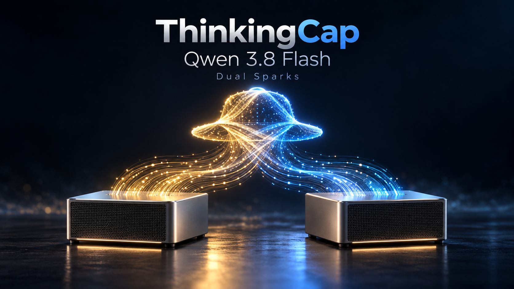

# ThinkingCap Qwen 3.8 Flash on Dual Sparks



This is my daily ThinkingCap serving profile for two NVIDIA Spark systems. I use it for high concurrency agentic research. It has become my personal gold standard on this hardware, and I’m sharing it for others to try.

In my October 26–28 workload, the median run used **50.4% fewer generated tokens** and finished **51.7% sooner** than the previous NVFP4 setup. Completed runs per worker-hour increased by approximately **1.86×**. Actionable findings per worker-hour stayed nearly unchanged.

## Results from my workflow

| Metric | Previous NVFP4, Oct 21–24 | ThinkingCap, Oct 26–28 |
| --- | ---: | ---: |
| Completed / started research runs | 698 / 698 | 946 / 955 |
| Median run duration | 48.7 min | 23.5 min |
| 90th-percentile duration | 93.1 min | 51.0 min |
| Median generated tokens | 46,116 | 22,894 |
| Median input tokens served, including cached context | 5.55 million | 3.66 million |
| Median model calls per completed run | 47 | 37 |
| Currently actionable Medium/High/Critical findings | 7 | 5 |
| Those findings per 100 worker-hours | 1.05 | 1.03 |

Generated tokens include output and reasoning. Repeated usage events were deduplicated; missing usage was not counted as zero.

Worker-hours sum run duration across concurrent workers.

These are observations from my own workload, not a controlled comparison of identical tasks. The findings sample is small. [Measurement notes](docs/results.md) explain the scope and calculations.

## Prefill and aggregate prose decode

Recorded on two Sparks on October 25, 2026, with thinking disabled and temperature 0.

| Prompt tokens | Cold prefill, tokens/s | Cold TTFT | Warm TTFT | Warm cached tokens |
| ---: | ---: | ---: | ---: | ---: |
| 10,282 | 3,034 | 3.39 s | 0.104 s | 10,224 |
| 41,044 | 3,201 | 12.82 s | 0.157 s | 40,992 |

Cold prefill is prompt tokens divided by time to first token. Warm rows repeat the same prompt and measure prefix-cache reuse.

| Concurrent prose streams | Aggregate decode, tokens/s | End-to-end output, tokens/s |
| ---: | ---: | ---: |
| 1 | 61.3 | 60.4 |
| 4 | 157.4 | 156.0 |
| 16 | 356.3 | 354.4 |

Each stream generated 400 tokens. Aggregate decode spans the batch’s first streamed token to its last completed response; end-to-end output also includes initial latency. These are single batches at each concurrency. [Recorded data](benchmarks/serving-2026-10-25.json) and [measurement details](docs/results.md#serving-measurements) are included.

## What’s improved

- **Prefix-cache reuse.** Shared system prompts and conversation history can carry over between agent turns. GDN and PLE prefill checkpoints support 64-token cache matching, and draft-prefix retention keeps the drafter compatible with reused context.
- **DFlash2 speculation.** A dedicated drafter proposes three tokens at a time for the target model to verify, reducing the number of target decoding steps when proposals are accepted.
- **Refined draft head.** NVFP4 scoring selects a 128-token shortlist, which is rescored with the original BF16 weights before target verification.
- **Adaptive dense precision.** Small projection batches use FP8; larger prefill batches retain BF16. This applies to selected target and draft projections.
- **Selective history lookup.** Repeated text can supply draft proposals after an eight-token history match and agreement with the drafter’s first-position choice. The target still verifies the proposed tokens.
- **Prefill scheduling under load.** Long prompts are chunked, mixed prefill is capped at 4,096 tokens, and decode steps get room between prefill admissions. Queue scanning lets eligible short requests progress behind a waiting long prompt.
- **Memory and execution.** FP8 KV cache leaves more room for context, while recurrent state stays FP32. CUDA graphs and RoCE collectives support decode across both Sparks; QSA workspace accounting includes temporary memory when sizing the cache.

## The running profile

Both Sparks serve one model using tensor parallelism over RoCE.

| Setting | Profile |
| --- | --- |
| Target | BottleCap AI ThinkingCap Qwen3.8 Flash Next NVFP4 |
| Draft model | Inco AI Qwen3.8 Flash Next DFlash2 |
| Concurrent sequences | 16 |
| Maximum context per request | 262,144 tokens, native RoPE |
| KV cache | FP8; 28 billion bytes per rank |
| Recurrent state | FP32 |
| Speculation | DFlash2, three speculative tokens; refined NVFP4 draft head |
| Dense projections | Adaptive FP8 for small batches; BF16 for larger batches |
| Prefix reuse | GDN/PLE prefill checkpoints; 64-token match unit |
| Prefill | 8,192-token batch; local cadence under decode pressure |
| Tool / reasoning parsing | `qwen3_xml` / `qwen3` |

Sixteen sequences share the available cache; this is not capacity for sixteen simultaneous full-length contexts. The checkpoint files are unchanged. Quantization hooks act at load time.

## Install and run

From the head Spark:

```bash
git clone https://github.com/x00byte/ThinkingCap-Qwen3.8-Flash-Dual-Spark.git
cd ThinkingCap-Qwen3.8-Flash-Dual-Spark
./install.sh --worker user@spark-b
```

Replace `user@spark-b` with the worker’s SSH login or configured SSH alias. Both hosts need ARM64 Linux, Python 3.10+, Docker with NVIDIA GPU support available to your user, a configured RoCE link, and about 200 GB of free disk. SSH to the worker must already work without a password prompt, with its host key trusted.

The script detects the fabric, copies the recipe to the worker, builds the pinned runtime on both hosts, downloads and verifies the target and draft, writes configuration, starts both ranks, and waits for the API. Host Python packages and the Hugging Face CLI do not need a separate installation. Downloads use the Hub library inside the pinned image.

Re-run `./install.sh` to resume preparation or reuse a matching running installation. Use `./install.sh --worker user@spark-b --plan` to preview the workflow, or add `--prepare-only` to download and build before a maintenance window. Existing GPU services must be drained and stopped through their own launcher before starting ThinkingCap.

Defaults store models and caches under `~/.local/share/thinkingcap-qwen38` on each host. [Setup and recovery](docs/setup.md) covers custom paths, network overrides and manual operation.

The installer has automated tests and CPU runtime checks. A complete installation through this script on idle Sparks has not yet been GPU-tested.

No license has been selected for my original work in this repository. Bundled third-party source retains its own licenses; model terms apply to downloaded weights. See [third-party notices](THIRD_PARTY.md).

## Credits

- [BottleCap AI](https://huggingface.co/bottlecapai/ThinkingCap-Qwen3.8-Flash-Next-NVFP4): ThinkingCap fine-tune and NVFP4 checkpoint, based on [Qwen3.8 Flash Next](https://huggingface.co/Qwen/Qwen3.8-Flash-Next).
- [Inco AI / DFlash](https://huggingface.co/incoai/Qwen3.8-Flash-Next-DFlash2): DFlash2 draft model and speculative decoding work.
- [myllmbox](https://github.com/myllmbox/qwen38-flash-next-cluster-recipe): Spark serving runtime, MBX hooks, cluster recipe and GDN/PLE checkpoint integration.
- [vLLM](https://github.com/vllm-project/vllm) and [B12X](https://github.com/local-inference-lab/b12x): serving engine and Blackwell kernels/communication.
- [HyperQwen](https://github.com/syv-ai/HyperQwen): lookup-augmented drafting kernel adapted for this profile.
